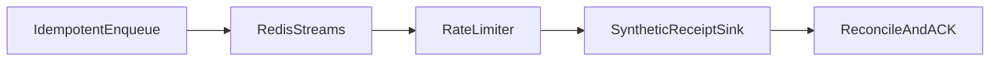

1. Queue-based sender with rate limits, dedupe, retries and delivery-status reconciliation.

2. Result:
   Messages delivered under worker-crash chaos: 200  
   Duplicate-send rate: 0.0  
   p99 enqueue-to-send: 631.4029693603516 ms  

   Measured with `make bench`: [raw results](evidence/bench.json), [command output](evidence/checks.log), [environment](evidence/environment.json).

3. Architecture:


4. Run it:
```sh
make setup
make lint test bench
make demo
```

5. Decisions and limits: Real Redis Streams and Lua operations; destinations and message contents are synthetic and no messages are sent externally. A worker physically exits after receipt creation but before sender ACK/status; replacement processing reconciles the existing receipt. Retryable timeouts are injected before delivery; Redis enforces the shared rate schedule. Exactly-once sink effects rely on sink-side idempotency in Redis, not on an arbitrary email/SMS provider. Redis server crashes, durable failover and multiple hosts are not covered; this benchmark disables persistence for an isolated temporary server. evidence/reconciliation.json retains per-message receipts, counts and queue status.

6. Next: Add provider adapters with idempotency contracts, durable Redis configuration and multi-worker load tests.
